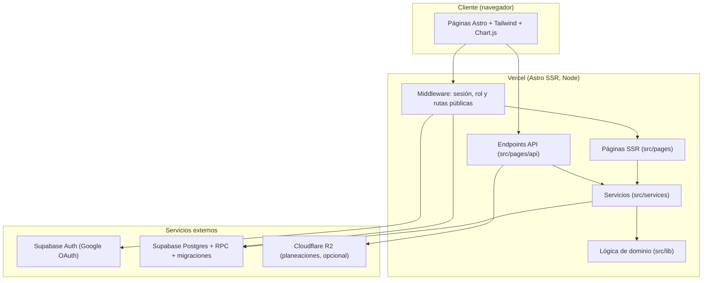

# SED-360 — Documentación técnica

Sistema de Evaluación Docente 360 del Tecnológico Universitario Playacar. Esta documentación describe el sistema tal como está implementado en el repositorio: propósito, arquitectura, modelo de datos, API, despliegue y estándares de contribución.

## Contenido

1. [Visión general y propósito del sistema](#1-visión-general-y-propósito-del-sistema)
2. [Arquitectura y stack tecnológico](#2-arquitectura-y-stack-tecnológico)
3. [Modelo de datos y almacenamiento](#3-modelo-de-datos-y-almacenamiento)
4. [Especificación de API e interfaces](#4-especificación-de-api-e-interfaces)
5. [Configuración local, ejecución y despliegue](#5-configuración-local-ejecución-y-despliegue)
6. [Estándares de código y contribución](#6-estándares-de-código-y-contribución)

---

## 1. Visión General y Propósito del Sistema

**SED-360** (Sistema de Evaluación Docente 360°) es una aplicación web del Tecnológico Universitario Playacar que consolida, por ciclo cuatrimestral, la evaluación del desempeño de cada docente a partir de varios instrumentos y calcula una calificación final con su categoría de desempeño.

### Problema que resuelve

- Reúne en un solo lugar los instrumentos de evaluación (encuesta estudiantil, evaluación de coordinación, planeación didáctica, observación de clase y autodiagnóstico).
- Precalcula y persiste la calificación final por docente (`calificaciones_finales`) para que dashboards y reportes lean datos consistentes (vista materializada `resultados_agregados`).
- Controla quién puede ver y capturar cada instrumento mediante roles y ventanas de captura.

### Alcance

Incluye importación de ofertas académicas, grupos, alumnos y asignaciones (CSV), captura de instrumentos, cálculo de calificaciones, reportes por docente (incluida exportación PDF con `pdfmake`) y administración del ciclo. El acceso se restringe al dominio institucional (constante `DOMINIO_PERMITIDO` en `src/lib/auth.ts`).

### Roles y actores

Definidos en `src/lib/roles.ts` (`superadmin`, `coordinador`, `docente`, `estudiante`, `observador`, `pendiente`):

| Rol | Destino inicial | Responsabilidad |
|---|---|---|
| `superadmin` | `/admin/dashboard` | Administración total: importaciones, ciclos, recálculo y resultados. |
| `coordinador` | `/coordinador/dashboard` | Evaluación de coordinación, revisión de planeaciones y reportes. |
| `observador` | `/observador/dashboard` | Realiza observaciones de clase. |
| `docente` | `/docente/dashboard` | Consulta su avance y responde el autodiagnóstico. |
| `estudiante` | `/estudiante/dashboard` | Responde la encuesta estudiantil. |
| `pendiente` | `/pendiente` | Usuario autenticado sin rol asignado; espera aprobación. |

### Instrumentos y ponderaciones

Pesos definidos en `src/services/scoring.ts` (`WEIGHTS` y `MODALITY_PROFILES`):

| Instrumento | Clave en código | Perfil normal | Perfil NP |
|---|---|---|---|
| Encuesta estudiantil | `ee` | 35 % | 40 % |
| Evaluación de coordinación | `coord` | 20 % | 25 % |
| Planeación | `plan` | 15 % | 0 % |
| Observación | `obs` | 25 % | 30 % |
| Autodiagnóstico | `auto` | 5 % | 5 % |

El perfil NP (4 instrumentos, 40/25/0/30/5) se aplica a asignaturas NP y de "Corrección", que se excluyen del promedio de planeación (`excludesPlanning`).

### Categorías 360

Definidas en `src/lib/categoria360.ts`. Las puntuaciones llevan decimales, por lo que cada categoría inicia en su límite inferior:

| Categoría | Rango |
|---|---|
| Sobresaliente | 95-100 |
| Eficaz | 86-94 |
| Adecuado | 76-85 |
| Proceso de Mejora | 66-75 |
| Desempeño Crítico | 0-65 |


## 2. Arquitectura y Stack Tecnológico

### Diagrama por capas



### Stack

| Tecnología | Versión (`package.json`) | Justificación |
|---|---|---|
| Astro | ^5.18.2 | Renderizado en servidor (`output: 'server'`) con páginas y endpoints en un solo proyecto. |
| @astrojs/vercel | ^8.2.11 | Adaptador de despliegue en Vercel. |
| @astrojs/node | ^9.5.5 | Dependencia del adaptador Node de Astro. |
| @astrojs/tailwind / tailwindcss | ^5.1.4 / ^3.4.17 | Estilos utilitarios. |
| @supabase/supabase-js | ^2.105.3 | Autenticación, base de datos Postgres y RPC. |
| @aws-sdk/client-s3 y s3-request-presigner | ^3.1091.0 | Cliente compatible con S3 para Cloudflare R2 y URLs prefirmadas de subida. |
| zod | ^3.25.76 | Validación de entradas. |
| chart.js | ^4.5.1 | Gráficas en dashboards. |
| pdfmake | ^0.3.11 | Generación de reportes PDF. |
| ws | ^8.20.0 | Polyfill de WebSocket para el cliente de Supabase. |
| vitest | ^4.1.10 | Pruebas unitarias. |
| Node.js | 22.x (`engines`) | Entorno de ejecución. |

### Flujo de datos de extremo a extremo

1. El usuario entra en `/auth` y elige "Continuar con Google"; Supabase Auth gestiona el flujo OAuth con la cuenta institucional.
2. Los endpoints bajo `/api/auth/*` (por ejemplo `guardar-sesion`) establecen la sesión.
3. El middleware (`src/middleware.ts`) deja pasar las rutas públicas (`RUTAS_PUBLICAS`), valida la sesión, resuelve el rol con la RPC `resolver_rol_autenticado` y lo compara con `ROLES_POR_RUTA` (por ejemplo `/admin` solo para `superadmin`; `/estudiante` solo para `estudiante`). Ante fallos del proveedor responde con un error de servicio no disponible y registra `upstream_unavailable`.
4. Las páginas y endpoints usan servicios que consultan Supabase con un cliente con la sesión del usuario (`crearClienteConSesion`) o, para operaciones administrativas del servidor, con el cliente de rol de servicio (`obtenerClienteAdmin`).
5. Al enviar un instrumento se guarda la respuesta y se calcula el puntaje; `calcFinalScore` aplica el perfil de ponderación y `categoryForScore` asigna la categoría. Los resultados se persisten en `calificaciones_finales` y se refrescan en `resultados_agregados` (tras importaciones de asignaciones y mediante `/api/admin/refrescar-resultados`).
6. Las planeaciones se almacenan en Cloudflare R2 mediante URLs prefirmadas (`src/lib/storage.ts`); R2 solo se activa si su configuración está completa y es válida.


## 3. Modelo de Datos y Almacenamiento

La base de datos es PostgreSQL gestionado por Supabase, esquema `public`. La fuente de verdad son las migraciones de `supabase/migrations/` (numeradas; las posteriores reemplazan a las anteriores). Esta sección refleja el esquema efectivo tras la migración `125_admin_teacher_survey_progress.sql`. Todas las tablas de `public` tienen Row Level Security (RLS) habilitado.

Convenciones: `NN` = `NOT NULL`; `PK` = clave primaria; `FK` = clave foránea. Los tipos `uuid` de usuarios provienen de `auth.users` (Supabase Auth).

### 3.1 Diagrama entidad-relación

```mermaid
erDiagram
    cuatrimestres ||--o{ grupos : "periodo"
    cuatrimestres ||--o{ inscripciones : "periodo"
    asignaturas ||--o{ grupos : "materia"
    docentes ||--o{ grupos : "imparte"
    estudiantes ||--o{ inscripciones : "cursa"
    grupos ||--o{ inscripciones : "contiene"
    usuarios }o--o| docentes : "entidad_id (rol docente)"
    usuarios }o--o| estudiantes : "entidad_id (rol estudiante)"

    usuarios ||--o{ coordinated_teacher_assignments : "coordinador_id"
    docentes ||--o{ coordinated_teacher_assignments : "docente_id"
    cuatrimestres ||--o{ coordinated_teacher_assignments : "periodo"
    usuarios ||--o{ observation_teacher_assignments : "evaluator_id"
    docentes ||--o{ observation_teacher_assignments : "docente_id"
    cuatrimestres ||--o{ observation_teacher_assignments : "periodo"

    instrument_definitions ||--o{ instrument_versions : "versiones"
    instrument_versions ||--o{ instrument_sections : "secciones"
    instrument_sections ||--o{ instrument_items : "reactivos"
    instrument_versions ||--o{ instrument_submissions : "version_id"
    docentes ||--o{ instrument_submissions : "evaluado"
    usuarios ||--o{ instrument_submissions : "submitted_by"
    instrument_submissions ||--o{ instrument_answers : "respuestas"
    instrument_items ||--o{ instrument_answers : "item_id"
    instrument_submissions ||--o{ instrument_evidence : "evidencia"
    instrument_sections ||--o{ instrument_evidence : "section_id"
    instrument_submissions ||--o| instrument_submissions : "supersedes_submission_id"
    instrument_versions ||--o{ instrument_submission_drafts : "borradores"
    usuarios ||--o{ instrument_submission_drafts : "submitted_by"

    estudiantes ||--o{ encuesta_control_envio : "envio"
    grupos ||--o{ encuesta_control_envio : "grupo"
    estudiantes ||--o{ encuesta_estudiantil_exclusiones : "excluido"
    grupos ||--o{ encuesta_estudiantil_exclusiones : "grupo"
    grupos ||--o{ encuesta_estudiantil_respuestas : "grupo"
    docentes ||--o{ encuesta_estudiantil_respuestas : "evaluado"

    docentes ||--o{ calificaciones_finales : "resultado"
    cuatrimestres ||--o{ calificaciones_finales : "periodo"
    docentes ||--o{ planeaciones : "sube"
    asignaturas ||--o{ planeaciones : "materia"
    docentes ||--o{ autodiagnosticos : "responde"
    cuatrimestres ||--o| autodiagnostico_submission_windows : "ventana"
    cuatrimestres ||--o{ institutional_notices : "avisos"

    import_runs ||--o{ import_issues : "incidencias"
    import_runs }o--o| cuatrimestres : "periodo"

    cuatrimestres { int id PK }
    docentes { int id PK }
    estudiantes { int id PK }
    asignaturas { int id PK }
    grupos { int id PK }
    inscripciones { int id PK }
    usuarios { uuid id PK }
    coordinated_teacher_assignments { bigint id PK }
    observation_teacher_assignments { bigint id PK }
    instrument_definitions { uuid id PK }
    instrument_versions { uuid id PK }
    instrument_sections { uuid id PK }
    instrument_items { uuid id PK }
    instrument_submissions { uuid id PK }
    instrument_answers { uuid submission_id PK }
    instrument_evidence { uuid id PK }
    instrument_submission_drafts { uuid id PK }
    encuesta_estudiantil_respuestas { int id PK }
    encuesta_control_envio { int id PK }
    encuesta_estudiantil_exclusiones { int estudiante_id PK }
    calificaciones_finales { bigint id PK }
    planeaciones { int id PK }
    autodiagnosticos { int id PK }
    autodiagnostico_submission_windows { int cuatrimestre_id PK }
    institutional_notices { bigint id PK }
    import_runs { int id PK }
    import_issues { bigint id PK }
```



Notas de lectura:

- No existe una tabla `notificaciones`. Los avisos a usuarios se modelan con `institutional_notices` (avisos institucionales dirigidos por rol y, opcionalmente, por cuatrimestre).
- La relación `usuarios.entidad_id` es lógica (entero sin FK declarada): apunta a `docentes.id` o a `estudiantes.id` según `usuarios.rol`.
- `instrument_answers` tiene PK compuesta `(submission_id, item_id)`; el diagrama muestra solo la primera columna por limitación de notación.
- `encuesta_estudiantil_exclusiones` tiene PK compuesta `(estudiante_id, cuatrimestre_id, grupo_id)`.
- Los resultados de la encuesta (`encuesta_estudiantil_respuestas`) son anónimos: no contienen `estudiante_id`. La traza de quién ya respondió vive aparte, en `encuesta_control_envio`.

### 3.2 Diccionario de datos

#### 3.2.1 Catálogo académico

**`cuatrimestres`** (periodos/ciclos de evaluación)

| Columna | Tipo | Null / Default | Notas |
|---|---|---|---|
| `id` | integer | PK, serial | |
| `clave` | varchar | NN | UNIQUE (`cuatrimestres_clave_key`) |
| `nombre` | varchar | NULL | |
| `fecha_inicio`, `fecha_fin` | varchar | NN | Almacenadas como texto |
| `activo` | boolean | default `true` | |
| `cerrado` | boolean | default `false` | |
| `created_at` | timestamp | default `CURRENT_TIMESTAMP` | |
| `es_prueba` | boolean | NN, default `false` | Marca ciclos de prueba, eliminables con `delete_test_cycle` |

**`docentes`**

| Columna | Tipo | Null / Default | Notas |
|---|---|---|---|
| `id` | integer | PK, serial | |
| `nombre`, `apellidos` | varchar | NN | PII |
| `apellido_paterno`, `apellido_materno` | varchar | NULL | PII |
| `email` | varchar | NULL | UNIQUE (`docentes_email_key`); PII |
| `num_empleado` | varchar | NULL | UNIQUE; índice funcional normalizado `idx_docentes_num_empleado_normalizado` |
| `licenciatura_id` | integer | NULL | FK `licenciaturas(id)` |
| `campus`, `turno`, `oferta_academica` | varchar / text | NULL | |
| `modalidad` | text | default `'Escolarizado'` | |
| `foto_url` | varchar | NULL | |
| `activo` | boolean | default `true` | |
| `visible_dashboard` | boolean | default `true` | |
| `nombre_normalizado` | varchar | NULL | Apoyo a la importación |
| `created_at` | timestamp | default `CURRENT_TIMESTAMP` | |

**`estudiantes`**

| Columna | Tipo | Null / Default | Notas |
|---|---|---|---|
| `id` | integer | PK, serial | |
| `nombre`, `apellidos` | varchar | NN | PII |
| `email` | varchar | NN | UNIQUE (`estudiantes_email_key`); PII |
| `matricula` | varchar | NN | UNIQUE (`estudiantes_matricula_key`); PII |
| `licenciatura_id` | integer | NULL | FK `licenciaturas(id)` |
| `cuatrimestre_actual` | integer | NULL | |
| `activo` | boolean | default `true` | Los inactivos se excluyen del avance de encuestas (migración 117) |
| `created_at` | timestamp | default `CURRENT_TIMESTAMP` | |

**`asignaturas`**

| Columna | Tipo | Null / Default | Notas |
|---|---|---|---|
| `id` | integer | PK, serial | |
| `clave` | varchar | NN | UNIQUE (`asignaturas_clave_key`) |
| `nombre` | varchar | NN | |
| `licenciatura_id` | integer | NULL | FK `licenciaturas(id)` |
| `oferta_academica_id` | integer | NULL | FK `ofertas_academicas(id)` |
| `cuatrimestre_num` | integer | NULL | |
| `creditos` | integer | default `5` | |
| `modalidad` | varchar | NULL | |
| `activa` | boolean | default `true` | |

**`grupos`**

| Columna | Tipo | Null / Default | Notas |
|---|---|---|---|
| `id` | integer | PK, serial | |
| `clave` | varchar | NN | |
| `asignatura_id`, `docente_id`, `cuatrimestre_id` | integer | NULL | FK a `asignaturas`, `docentes`, `cuatrimestres` |
| `num_alumnos` | integer | default `0` | |
| `modalidad` | varchar | default `'Escolarizado'` | |
| `turno_grupo`, `plan_normalizado`, `grado`, `grupo_normalizado` | varchar | NULL | Identidad de importación |
| `importacion_key` | varchar | NULL | UNIQUE parcial `uq_grupos_importacion_key` (`WHERE importacion_key IS NOT NULL`) |
| `encuesta_estudiantil_habilitada` | boolean | NN, default `true` | Permite deshabilitar la encuesta por grupo (migración 110) |
| `instrumento_encuesta` | varchar | NN, default `'general-19'` | CHECK: `general-19`, `cd07-v1`, `pp04-v1`, `sim05-v1`, `cc06-v1` |
| `activo` | boolean | default `true` | |

Índices: `idx_grupos_cuatrimestre (cuatrimestre_id)`, `idx_grupos_docente (docente_id)`, `grupos_assignment_import_identity_idx (cuatrimestre_id, asignatura_id, plan_normalizado, grupo_normalizado) WHERE activo`, `grupos_assignment_import_key_idx (cuatrimestre_id, asignatura_id, importacion_key) WHERE activo AND importacion_key IS NOT NULL`, `idx_grupos_importacion_identidad` e `idx_grupos_importacion_ciclo_identidad (cuatrimestre_id, plan_normalizado, grado, grupo_normalizado)`.

**`inscripciones`**

| Columna | Tipo | Null / Default | Notas |
|---|---|---|---|
| `id` | integer | PK, serial | |
| `estudiante_id`, `grupo_id`, `cuatrimestre_id` | integer | NULL | FK a `estudiantes`, `grupos`, `cuatrimestres` |
| `fecha` | date | default `CURRENT_DATE` | |

Unique: `inscripciones_estudiante_grupo_cuatrimestre_key (estudiante_id, grupo_id, cuatrimestre_id)`. Índices: `idx_inscripciones_estudiante`, `inscripciones_assignment_import_source_idx (grupo_id, cuatrimestre_id)`.

Catálogos auxiliares: `licenciaturas`, `ofertas_academicas`, `campus`, `turnos` (id, nombre, activo) y `horarios_grupo` (horarios por grupo: `grupo_id`, `dia_semana`, `hora_inicio`, `hora_fin`, `aula`, `activo`, `recurrence_mode`, `specific_dates`).

#### 3.2.2 Identidad y asignaciones

**`usuarios`** (perfil de aplicación enlazado a `auth.users`)

| Columna | Tipo | Null / Default | Notas |
|---|---|---|---|
| `id` | uuid | PK, NN | FK `auth.users(id)` |
| `email` | text | NN | UNIQUE (`usuarios_email_key`); PII |
| `rol` | varchar | NN | CHECK (`NOT VALID`): `superadmin`, `coordinador`, `docente`, `estudiante`, `observador`, `pendiente` |
| `rol_solicitado` | varchar | NULL | Rol solicitado en el registro |
| `entidad_id` | integer | NULL | `docentes.id` o `estudiantes.id` según el rol (sin FK) |
| `activo` | boolean | default `true` | |
| `ultimo_acceso` | timestamp | NULL | |
| `created_at` | timestamp | default `CURRENT_TIMESTAMP` | |

Triggers: `audit_row_change_trigger`, `trg_limpiar_entidad` (limpia `entidad_id` al cambiar de rol), `trg_resolver_rol_usuario_pendiente` (BEFORE INSERT/UPDATE).

**`coordinated_teacher_assignments`** (qué coordinador evalúa a qué docente en un ciclo)

| Columna | Tipo | Null / Default | Notas |
|---|---|---|---|
| `id` | bigint | PK | |
| `coordinador_id` | uuid | NN | FK `usuarios(id)` |
| `docente_id` | integer | NN | FK `docentes(id)` |
| `cuatrimestre_id` | integer | NN | FK `cuatrimestres(id)` |
| `assigned_at` | timestamptz | NN, default `now()` | |
| `assigned_by`, `revoked_by` | uuid | NULL | FK `usuarios(id)` |
| `revoked_at` | timestamptz | NULL | Baja lógica |
| `source` | text | NN, default `'admin'` | CHECK: `admin`, `legacy_backfill` |

Constraints/índices: CHECK `(revoked_at IS NULL) = (revoked_by IS NULL)`; UNIQUE parcial `coordinated_teacher_assignments_active_unique (coordinador_id, docente_id, cuatrimestre_id) WHERE revoked_at IS NULL`; índice parcial `coordinated_teacher_assignments_cycle_teacher_idx (cuatrimestre_id, docente_id) WHERE revoked_at IS NULL`. Trigger `validate_coordinated_teacher_assignment_actor`.

**`observation_teacher_assignments`** (qué observador/evaluador observa a qué docente)

Misma forma que la anterior, con `evaluator_id` (uuid NN, FK `usuarios(id)`) en lugar de `coordinador_id`, y `source` CHECK: `admin`, `legacy_backfill`, `automatic_allocation`. Unique parcial `observation_teacher_assignments_active_unique (evaluator_id, docente_id, cuatrimestre_id) WHERE revoked_at IS NULL`; índice parcial `observation_teacher_assignments_cycle_teacher_idx`. CHECK `(revoked_at IS NULL) = (revoked_by IS NULL)`.

Tablas de apoyo a la asignación automática: `observation_allocation_preferences`, `observation_allocation_previews`, `observation_allocation_runs` y `teacher_assignment_backfill_review`.

#### 3.2.3 Instrumentos versionados (coordinación, observación, planeación)

**`instrument_definitions`**: `id` uuid PK, `code` text NN, `purpose` text NN, `title` text NN, `created_at` timestamptz NN.

**`instrument_versions`**

| Columna | Tipo | Null / Default | Notas |
|---|---|---|---|
| `id` | uuid | PK | |
| `definition_id` | uuid | NN | FK `instrument_definitions(id)` |
| `version` | text | NN | UNIQUE `(definition_id, version)` |
| `effective_from` | timestamptz | NN | |
| `effective_to` | timestamptz | NULL | CHECK `effective_to IS NULL OR effective_to > effective_from` |
| `status` | text | NN, default `'active'` | CHECK: `draft`, `active`, `retired` |
| `scale_metadata`, `scoring_metadata` | jsonb | NN | Escala y reglas de puntuación |
| `created_at`, `retired_at` | timestamptz | NN / NULL | |

**`instrument_sections`** (`id`, `version_id`, `code`, `title`, `position`, `scored`), **`instrument_items`** (`id`, `version_id`, `section_id`, `code`, `label`, `guidance`, `position`, `scored`, `na_eligible`, `na_policy` jsonb) e **`instrument_administrative_checks`** (`id`, `version_id`, `section_code`, `code`, `label`, `position`, `na_eligible`, `applicability_policy` jsonb) describen el contenido de cada versión.

**`instrument_submissions`** (captura enviada; inmutable)

| Columna | Tipo | Null / Default | Notas |
|---|---|---|---|
| `id` | uuid | PK, default `gen_random_uuid()` | |
| `version_id` | uuid | NN | FK `instrument_versions(id)` |
| `purpose` | text | NN | CHECK: `coordination`, `planning`, `observation` |
| `docente_id` | integer | NN | FK `docentes(id)` |
| `cuatrimestre_id` | integer | NN | FK `cuatrimestres(id)` |
| `submitted_by` | uuid | NN | FK `usuarios(id)` |
| `source_record_id` | integer | NULL | Para `planning`, id de `planeaciones` (obligatorio por CHECK) |
| `asignatura_id` | integer | NULL | FK `asignaturas(id)` |
| `grupo` | text | NULL | |
| `validity_status` | text | NN | CHECK: `valid`, `invalid_excessive_na` |
| `raw_score`, `normalized_score` | numeric | NULL | `normalized_score` es obligatorio si `valid` y `NULL` si `invalid_excessive_na` |
| `na_count`, `applicable_item_count` | integer | NN, default `0` | CHECK `>= 0` |
| `definition_snapshot` | jsonb | NN | Copia congelada de la definición usada |
| `metadata` | jsonb | NN, default `'{}'` | |
| `submitted_at` | timestamptz | NN, default `now()` | |
| `revision_kind` | text | NN, default `'initial'` | `initial` o `revision` |
| `supersedes_submission_id` | uuid | NULL | FK recursiva: la revisión apunta a su predecesora |
| `operation_id` | uuid | NULL | Idempotencia de reevaluaciones |
| `operation_payload_hash` | text | NULL | Hash hexadecimal del payload de la operación |

Índices y unicidad:

- `instrument_submissions_one_coordination_capture` UNIQUE `(docente_id, cuatrimestre_id, purpose, version_id) WHERE purpose = 'coordination'`: una sola captura de coordinación por docente, ciclo y versión.
- `instrument_submissions_one_observation_capture` UNIQUE `(docente_id, cuatrimestre_id, purpose, version_id) WHERE purpose = 'observation' AND revision_kind = 'initial'`.
- `instrument_submissions_one_planning_capture` UNIQUE `(source_record_id, version_id) WHERE purpose = 'planning'`.
- `instrument_submissions_one_revision_per_operation` UNIQUE `(operation_id) WHERE revision_kind = 'revision'`.
- `instrument_submissions_one_revision_per_predecessor` UNIQUE `(supersedes_submission_id) WHERE revision_kind = 'revision'`: cada captura tiene como máximo una revisión directa.
- `instrument_submissions_cycle_teacher_idx (cuatrimestre_id, docente_id, purpose, submitted_at DESC)`.

CHECKs destacados: `instrument_submissions_revision_tuple_check` (una captura `initial` no lleva predecesora ni operación; una `revision` exige `purpose = 'observation'`, predecesora, `operation_id` y hash hexadecimal), `instrument_submissions_check` (coherencia entre `validity_status` y `normalized_score`) e `instrument_submissions_check1` (planeación exige `source_record_id`).

**`instrument_answers`**: PK `(submission_id, item_id)`; `submission_id` FK `instrument_submissions(id) ON DELETE CASCADE`, `item_id` FK `instrument_items(id)`, `cuatrimestre_id` FK, `numeric_value` numeric, `is_na` boolean NN default `false`, `na_reason` text. CHECK `instrument_answers_check`: o bien `is_na` con valor nulo y motivo no vacío, o bien no `is_na` con valor numérico y sin motivo.

**`instrument_evidence`**: `id` uuid PK, `submission_id` FK (`ON DELETE CASCADE`), `cuatrimestre_id`, `section_id` FK `instrument_sections(id)`, `evidence` text NN. UNIQUE `(submission_id, section_id)`; CHECK `evidence` no vacío tras `TRIM`.

**`instrument_administrative_check_answers`**: `submission_id`, `cuatrimestre_id`, `check_id`, `value` text NN, `na_reason` text. Inmutable.

**`instrument_submission_drafts`** (borradores)

| Columna | Tipo | Null / Default | Notas |
|---|---|---|---|
| `id` | uuid | PK | |
| `submitted_by` | uuid | NN | FK `usuarios(id)` |
| `docente_id`, `cuatrimestre_id` | integer | NN | FK |
| `version_id` | uuid | NN | FK `instrument_versions(id)` |
| `draft` | jsonb | NN, default `'{}'` | CHECK `jsonb_typeof(draft) = 'object'` |
| `operation_id`, `supersedes_submission_id` | uuid | NULL | CHECK: ambos nulos o ambos presentes (borrador de revisión) |
| `created_at`, `updated_at` | timestamptz | NN | |

UNIQUE `(submitted_by, docente_id, cuatrimestre_id, version_id)`; UNIQUE parcial `instrument_submission_drafts_operation_unique (operation_id) WHERE operation_id IS NOT NULL`; índice `instrument_submission_drafts_cycle_teacher_idx`. Al insertarse una captura de observación, el trigger `instrument_submissions_discard_observation_drafts_trigger` descarta sus borradores.

**`instrument_submission_windows`** y **`planning_submission_windows`** (ventanas de captura por ciclo): `cuatrimestre_id`, `mode` (`manual_open`, `manual_closed`, `scheduled`), `opens_at`, `closes_at`, `created_by`, `updated_by`, marcas de tiempo. La primera además incluye `purpose` (`coordination` u `observation`). CHECK: `scheduled` exige ambas fechas con `opens_at < closes_at`; los modos manuales exigen ambas nulas.

#### 3.2.4 Encuesta estudiantil

**`encuesta_estudiantil_respuestas`** (respuesta anónima por grupo)

| Columna | Tipo | Null / Default | Notas |
|---|---|---|---|
| `id` | integer | PK, serial | |
| `docente_id`, `grupo_id`, `cuatrimestre_id` | integer | NULL | FK; sin identificador de estudiante |
| `fecha_respuesta` | timestamp | default `CURRENT_TIMESTAMP` | |
| `calidad_general` | smallint | NULL | CHECK 1 a 6 (y 1 a 5 en `encuesta_estudiantil_calidad_general_1_5`) |
| `item_*` (19 reactivos: `item_plan_estudio`, `item_trato_respeto`, `item_asistencia`, `item_puntualidad`, `item_participacion`, `item_dominio_materia`, `item_plataforma_moodle`, `item_pensamiento_critico`, `item_desafio_intelectual`, `item_claridad_objetivos`, `item_lecturas_aprendizaje`, `item_respeto_reglas`, `item_interes_materia`, `item_apoyos_didacticos`, `item_actitudes_valores`, `item_retroalimentacion`, `item_criterios_evaluacion`, `item_receptividad`) | smallint | NULL | CHECK 1 a 5 cada uno |
| `instrumento` | varchar | NN, default `'general-19'` | CHECK de forma `encuesta_estudiantil_instrumento_forma` |
| `respuestas_instrumento` | array | NULL | Respuestas de los instrumentos especializados (`cd07-v1`, `pp04-v1`, `sim05-v1`, `cc06-v1`) |
| `comentario_abierto` | text | NULL | Texto libre; PII potencial |
| `clasificacion_comentario` | varchar | default `'neutro'` | CHECK: `excelente`, `neutro`, `a_mejorar`, `critico`, `foco_rojo` |
| `anonimo` | boolean | default `true` | |
| `comentario_validado` | boolean | NN, default `false` | Solo los validados se muestran al docente |
| `comentario_validado_at`, `comentario_validado_por` | timestamptz / uuid | NULL | Auditoría de la revisión |
| `comentario_no_autorizado` | boolean | NN, default `false` | Nunca se muestra al docente |
| `comentario_sin_aporte` | boolean | NN, default `false` | Nunca se muestra al docente |

CHECK `encuesta_estudiantil_comentario_revision_chk`: la suma de `comentario_validado`, `comentario_no_autorizado` y `comentario_sin_aporte` (cada uno contado como 0 o 1) es como máximo 1; es decir, un comentario tiene a lo sumo un estado de revisión. Índices: `idx_encuesta_respuestas_docente`, `idx_encuesta_respuestas_grupo`, `encuesta_estudiantil_comentario_validado_idx (cuatrimestre_id, docente_id) WHERE comentario_validado`.

**`encuesta_control_envio`** (control de quién ya envió; rompe el vínculo con la respuesta)

| Columna | Tipo | Null / Default | Notas |
|---|---|---|---|
| `id` | integer | PK, serial | |
| `estudiante_id`, `grupo_id`, `cuatrimestre_id` | integer | NULL | FK |
| `fecha_envio` | timestamp | default `CURRENT_TIMESTAMP` | |

UNIQUE `(estudiante_id, grupo_id, cuatrimestre_id)`: un envío por estudiante, grupo y ciclo. Trigger `audit_student_evaluation_submitted_trigger`.

**`encuesta_estudiantil_exclusiones`**: PK `(estudiante_id, cuatrimestre_id, grupo_id)` (FK a `estudiantes`, `cuatrimestres`, `grupos`), `created_at` timestamptz NN, `reason_code` text NN con CHECK `reason_code ~ '^[a-z][a-z0-9_]{2,47}$'`. Triggers `validar_ciclo_exclusion_encuesta` (BEFORE INSERT/UPDATE) y `audit_exclusion_encuesta_row`. Registra exclusiones individuales de un estudiante en un grupo (migración 119).

**`encuesta_estudiantil`** (agregados heredados, solo lectura para superadmin) e **`instrumento_preguntas`** (catálogo de preguntas del instrumento nativo) completan el módulo.

#### 3.2.5 Resultados, planeaciones y autodiagnóstico

**`calificaciones_finales`** (snapshot del resultado final por docente y ciclo)

| Columna | Tipo | Null / Default | Notas |
|---|---|---|---|
| `id` | bigint | PK | |
| `docente_id`, `cuatrimestre_id` | integer | NN | FK; UNIQUE `(docente_id, cuatrimestre_id)` |
| `modalidad_snapshot` | text | NN | |
| `score_encuesta_estudiantil`, `score_coordinacion`, `score_planeacion`, `score_observacion`, `score_autoevaluacion` | numeric | NULL | Componentes |
| `calificacion_final` | numeric | NN | |
| `categoria_final` | text | NN | |
| `num_instrumentos_completados`, `num_instrumentos_esperados` | integer | NN | |
| `version_calculo` | text | NN, default `'v2.1'` | |
| `calculada_en` | timestamptz | default `now()` | |
| `instrument_validity` | jsonb | NN, default `'{}'` | |
| `has_invalid_instrument` | boolean | NN, default `false` | |

Índice `idx_calificaciones_finales_cuatrimestre_id`. Se escribe únicamente mediante la función `upsert_calificacion_final`. La tabla heredada `calificacion_final_docente` se conserva como referencia.

**`planeaciones`** (planeación didáctica subida por el docente)

| Columna | Tipo | Null / Default | Notas |
|---|---|---|---|
| `id` | integer | PK, serial | |
| `docente_id`, `cuatrimestre_id`, `asignatura_id` | integer | NULL | FK; UNIQUE `(docente_id, cuatrimestre_id, asignatura_id)` |
| `campus`, `turno`, `modalidad` | text | NULL | |
| `grupo` | text | NN | |
| `proyecto` | boolean | default `false` | |
| `laboratorio`, `visitas` | varchar | default `'No aplica'` | |
| `url_pdf` | text | NN | Ruta/clave del PDF en R2 (ver 3.6) |
| `nombre_archivo` | text | NULL | |
| `estado` | varchar | default `'Pendiente'` | CHECK: `Pendiente`, `Aprobado`, `Corrección` |
| `criterio_alineacion`, `criterio_secuencia`, `criterio_recursos`, `criterio_evaluacion` | smallint | NULL | CHECK 1 a 5 |
| `puntaje_promedio` | numeric | NULL | |
| `comentario_docente`, `comentario_retroalimentacion`, `comentario_interno`, `observaciones_generales` | text | NULL | |
| `evaluacion_detalle` | jsonb | NULL | |
| `no_aplica_count` | integer | default `0` | |
| `grupos_cubiertos` | array | NULL | |
| `fecha_subida`, `fecha_evaluacion` | timestamp | default `CURRENT_TIMESTAMP` / NULL | |
| `first_teacher_submitted_at`, `latest_teacher_submitted_at` | timestamptz | NULL | Mantenidas por el trigger `set_teacher_planning_submission_timestamps_trigger` |

Tablas de estado de planeación por grupo y materia: `planning_group_np`, `planning_group_document_status`, `planning_subject_np`.

**`autodiagnosticos`**: `id` serial PK, `docente_id`, `cuatrimestre_id` (FK; UNIQUE `autodiagnosticos_docente_id_cuatrimestre_id_key`), `r1` a `r24` smallint (CHECK 1 a 5 cada una), `puntaje_total` smallint, `nivel_desempeno` varchar, `comentarios` text, `fecha_respuesta` timestamp. Trigger `enforce_teacher_autodiagnostico_submission_window_trigger` (BEFORE INSERT) bloquea el alta fuera de ventana.

**`autodiagnostico_submission_windows`**: PK `cuatrimestre_id` (FK), `mode` (`manual_open`, `manual_closed`, `scheduled`), `opens_at`, `closes_at`, `created_by`/`updated_by` (uuid NN, FK `usuarios`), marcas de tiempo; mismo CHECK de coherencia modo/fechas que las demás ventanas.

Tablas heredadas de otros instrumentos (con RLS y políticas propias): `evaluacion_coordinacion`, `evaluacion_planeacion`, `observaciones`, `observacion_clase`, `autoevaluacion_docente`, `docente_360_feedback`, `coordinador_docentes`, `docente_modalidad_historica`.

`institutional_notices`: `id` bigint PK, `title`, `body`, `target_roles` text[] NN default `{}`, `cuatrimestre_id`, `image_path`, `image_alt_text`, `status` (default `'draft'`), `is_active`, `published_at`, `expires_at`, `created_by`/`updated_by` (uuid NN), marcas de tiempo.

#### 3.2.6 Importaciones y auditoría

**`import_runs`**: `id` serial PK, `tipo` varchar NN (CHECK: `docentes`, `asignaciones`, `alumnos`, `saeko`), `cuatrimestre_id` FK, `archivo_nombre`, `estado` (default `'processing'`), `filas_leidas` integer NN default `0`, `resumen` jsonb NN, `created_by` uuid FK `usuarios`, `created_at`, `finished_at`. Índice `idx_import_runs_tipo_fecha (tipo, created_at DESC)`.

**`import_issues`**: `id` bigint PK, `run_id` FK `import_runs(id) ON DELETE CASCADE`, `categoria` (CHECK: `docente`, `grupo`, `asignatura`, `fila`), `razon`, `fila`, `valor_original`, `valor_normalizado`, `plan`, `grupo`, `clave_asignatura`, `nombre_asignatura`, `docente`, `ciclo`, `cuatrimestre_id`, `detalles` jsonb, `resolution_status` text NN default `'open'` (CHECK: `open`, `resolved`, `superseded`), `resolved_at`, `resolved_by` (FK `usuarios`, `ON DELETE SET NULL`), `resolution_kind`, `resolved_group_id` (FK `grupos`, `ON DELETE SET NULL`). Índices `idx_import_issues_run (run_id, categoria)` e `import_issues_open_reconciliation_idx (cuatrimestre_id, id) WHERE resolution_status = 'open'`.

**`audit_events`**: bitácora de auditoría encadenada por hash (`previous_hash`, `integrity_hash`), con `actor_id`, `actor_role`, `source`, `action`, `table_name`, `operation`, `changed_fields`, y versiones `before_safe` / `after_safe` / `summary_safe` ya depuradas. Otras tablas: `change_sets`, `restore_points`, `test_cycle_storage_cleanup`.

### 3.3 Funciones SQL y RPC clave

Todas las funciones de esta lista se crean en el esquema `public`. Las marcadas SECURITY DEFINER fijan `SET search_path TO ''` y validan el rol dentro del cuerpo con `auth.uid()`. Nota: Postgres concede `EXECUTE` a `PUBLIC` por defecto, de modo que el grant por sí solo no limita el acceso; la barrera efectiva es la verificación interna descrita en la columna "Quién puede invocarla". Donde se indica `authenticated`/`service_role` es porque la migración revoca el permiso a `anon`.

| Función | Propósito | Quién puede invocarla |
|---|---|---|
| `resolver_rol_autenticado()` | Resuelve el rol del usuario autenticado a partir de `auth.uid()` y del email del JWT. Si no hay fila en `usuarios` la crea como `pendiente`; vincula automáticamente con `estudiantes` o `docentes` por email; actualiza `ultimo_acceso`. Devuelve el rol (`pendiente` si no se resuelve). | Cualquier usuario autenticado (opera solo sobre su propio `auth.uid()`) |
| `rol_usuario(uid)` | Devuelve `usuarios.rol` de un uid. Usada por las políticas RLS. | Interna / políticas RLS |
| `obtener_progreso_encuesta_estudiantil_nativa(p_cuatrimestre_id)` | Por docente: inscripciones elegibles, controles enviados y respuestas nativas. Las encuestas deshabilitadas solo cuentan inscripciones ya respondidas. | Roles `superadmin` y `coordinador` (error `42501` en otro caso) |
| `obtener_scores_encuesta_estudiantil_nativa(p_cuatrimestre_id)` | Puntajes agregados de la encuesta nativa por docente. | Personal (validado en el cuerpo) |
| `admin_seguimiento_encuestas_estudiantes(p_cuatrimestre_id)` | Seguimiento por estudiante: si tiene cuenta, último acceso, planes y avance de respuestas, excluyendo estudiantes inactivos. | Solo `superadmin` (`audit_is_superadmin()`); `authenticated`, `service_role` |
| `admin_avance_encuestas_docentes(p_cuatrimestre_id)` | Avance por docente/grupo/materia: `elegibles` frente a `respondidas`. | Solo `superadmin`; `authenticated`, `service_role` |
| `enviar_encuesta_estudiante`, `enviar_encuesta_estudiante_cd07`, `enviar_encuesta_estudiante_instrumento(p_grupo_id, p_instrumento, p_respuestas, p_comentario)` | Registra la respuesta anónima y el control de envío en una sola transacción. Exige rol `estudiante` activo, inscripción en el grupo y ciclo, encuesta habilitada y ausencia de envío previo; devuelve un `status` (por ejemplo `not_enrolled`). | Solo estudiantes autenticados (`student required`, `42501`) |
| `obtener_comentarios_estudiantiles_validados(p_cuatrimestre_id)` | Devuelve al docente únicamente sus comentarios con `comentario_validado = true`. | Solo rol `docente` activo |
| `obtener_evaluacion_estudiantil_docente(p_cuatrimestre_id)` | Resumen de la evaluación estudiantil del docente. | `authenticated`, `service_role` |
| `autodiagnostico_cycle_window_closed(p_cuatrimestre_id)` | `true` si la ventana efectiva del autodiagnóstico del ciclo está en estado `closed` o `scheduled_ended`; `false` en cualquier otro caso. | `authenticated`, `service_role` |
| `autodiagnostico_submission_window_save(...)` y `*_state`, `*_is_open`, `*_admin_list` | Administran y consultan la ventana del autodiagnóstico. | Administración (validado en el cuerpo) |
| `submit_versioned_instrument(p_version_id, p_docente_id, p_cuatrimestre_id, ...)` | Envía una captura versionada (coordinación, observación o planeación) con respuestas, evidencia por sección y checklist administrativo (17 checks para coordinación). Valida escala, N/A elegible con motivo y completitud, y escribe un evento de auditoría. | `superadmin`/`coordinador` con asignación de coordinación vigente; `superadmin`/`coordinador`/`observador` con asignación de observación vigente |
| `reevaluate_observation_instrument(...)` | Crea una revisión (`revision_kind = 'revision'`) de una observación, apuntando a su predecesora, con `operation_id` idempotente y hash del payload. Maneja los conflictos de concurrencia nombrados (`one_revision_per_operation`, `one_revision_per_predecessor`). | `superadmin`, `coordinador`, `observador` con asignación vigente |
| `save_/get_/delete_coordination_instrument_draft`, `save_/get_/delete_observation_instrument_draft`, `save_/get_/delete_observation_revision_draft` | Gestión de borradores con autorización por asignación. | `authenticated` |
| `can_manage_coordinated_teacher`, `can_observe_assigned_teacher`, `is_active_coordinator`, `is_active_observation_evaluator`, `is_active_superadmin`, `audit_is_superadmin` | Predicados de autorización reutilizados por RPC, triggers y políticas. | Internas |
| `upsert_calificacion_final(p_payload)` | Inserta o actualiza el snapshot de `calificaciones_finales`. | Ejecuta con SECURITY DEFINER; invocada por el backend |
| `assign_teacher_assignments`, `replace_teacher_assignments`, `revoke_teacher_assignments`, `preview_observation_allocation`, `confirm_observation_allocation` | Gestión de asignaciones y asignación automática de observadores con vista previa y huella (`fingerprint`). | Administración (validado en el cuerpo) |
| `apply_assignment_import_sync`, `apply_academic_offer_import` | Importaciones basadas en conjuntos de acciones (idempotentes). | Backend administrativo |
| `mark_test_cycle`, `delete_test_cycle`, `test_cycle_deletion_preview` | Marcado, vista previa y borrado de ciclos de prueba, con confirmación textual. | Superadmin |
| `audit_*` (`audit_create_change_set`, `audit_finish_change_set`, `audit_list_my_activity`, `audit_row_change`, etc.) | Registro y consulta de la bitácora de auditoría. | Según función; el listado completo es solo para superadmin |

### 3.4 Seguridad

#### 3.4.1 Row Level Security por tabla y rol

Todas las tablas de `public` tienen RLS activo. Hay dos grupos:

1. **Tablas con políticas para el rol `authenticated`/`public`** (usuarios de la aplicación con JWT). Se identifican por `rol_usuario(auth.uid())`:

| Tabla | Lectura | Escritura |
|---|---|---|
| `asignaturas`, `cuatrimestres`, `estudiantes`, `grupos`, `inscripciones`, `docentes` | Cualquier usuario autenticado (`auth.uid() IS NOT NULL`) | `superadmin` (ALL) en `asignaturas`, `cuatrimestres`, `estudiantes`, `inscripciones`; `superadmin` y `coordinador` en `grupos` y `docentes` |
| `docentes` | Autenticados | Además, política "Docente se autoregistra" (INSERT con verificación `EXISTS`) |
| `usuarios` | Cada usuario lee y actualiza solo su propio perfil (`id = auth.uid()`) | `superadmin` gestiona todos (ALL) |
| `planeaciones` | `superadmin` y `coordinador` (ALL) | El docente inserta la suya (INSERT con verificación) |
| `autodiagnosticos` | `superadmin` y `coordinador` | El docente inserta el suyo (INSERT con verificación) |
| `import_runs`, `import_issues` | Solo `superadmin` | Solo `superadmin` (INSERT; UPDATE en `import_runs`) |
| `encuesta_estudiantil` (heredada) | Solo `superadmin` | Sin política de escritura |

   Las tablas heredadas `autoevaluacion_docente`, `calificacion_final_docente`, `campus`, `coordinador_docentes`, `docente_360_feedback`, `evaluacion_coordinacion`, `evaluacion_planeacion`, `instrumento_preguntas`, `licenciaturas`, `observacion_clase`, `observaciones`, `ofertas_academicas` y `turnos` tienen dos políticas cada una (lectura y gestión) con el mismo patrón de rol.

2. **Tablas sin política (denegación total para `anon` y `authenticated`)**: `encuesta_estudiantil_respuestas`, `encuesta_control_envio`, `encuesta_estudiantil_exclusiones`, `calificaciones_finales`, `instrument_*` (definiciones, versiones, secciones, ítems, envíos, respuestas, evidencia, borradores, ventanas), `coordinated_teacher_assignments`, `observation_teacher_assignments`, `observation_allocation_*`, `horarios_grupo`, `institutional_notices`, `audit_events`, `change_sets`, `restore_points`, `planning_*` y `*_submission_windows`. Con RLS activo y sin política, solo se accede mediante RPC `SECURITY DEFINER` o con el rol de servicio del backend. Esto aplica en particular a los datos sensibles de la encuesta: ningún cliente puede hacer `SELECT` directo sobre las respuestas.

#### 3.4.2 SECURITY DEFINER

La lógica sensible se expone solo mediante funciones `SECURITY DEFINER` con `SET search_path TO ''` (todos los objetos se califican como `public.*`, lo que evita el secuestro de `search_path`). Cada función verifica identidad y rol a partir de `auth.uid()` antes de leer o escribir (por ejemplo `student required`, `teacher role required`, `staff role required`, `superadmin required`, siempre con `ERRCODE 42501`), y valida el identificador de ciclo (`valid cycle id required`, `22023`).

#### 3.4.3 Inmutabilidad de capturas

- Los triggers `instrument_submissions_immutable_trigger`, `instrument_answers_immutable_trigger`, `instrument_evidence_immutable_trigger` e `instrument_checks_immutable_trigger` se ejecutan BEFORE UPDATE OR DELETE sobre `instrument_submissions`, `instrument_answers`, `instrument_evidence` e `instrument_administrative_check_answers`. Invocan `instrument_submission_immutable()`, que lanza `submitted instruments are immutable` (`42501`). La única excepción es el borrado interno de ciclos de prueba (`audit_test_cycle_row_suppression_active()`).
- Las correcciones no modifican la captura original: se inserta una nueva fila con `revision_kind = 'revision'` que apunta a la anterior (`supersedes_submission_id`). El trigger `instrument_submissions_revision_guard_trigger` (BEFORE INSERT) valida la nueva revisión.
- `enforce_instrument_submission_window_trigger` (BEFORE INSERT) rechaza capturas de coordinación u observación fuera de la ventana abierta.
- `audit_events_append_only` (BEFORE INSERT/UPDATE/DELETE sobre `audit_events`, función `audit_events_integrity()`) protege la bitácora encadenada por hash.
- Los triggers `enforce_planning_assignment_authorization`, `enforce_coordination_assignment_authorization` y `enforce_observation_assignment_authorization` (función `enforce_staff_assignment_authorization`) impiden que personal sin asignación vigente evalúe a un docente.
- `trg_resolver_rol_usuario_pendiente` y `trg_limpiar_entidad` mantienen coherentes `rol` y `entidad_id` en `usuarios`.

#### 3.4.4 Límites de frecuencia y de tamaño

El proyecto corre en Vercel (sin estado compartido en memoria), por lo que el límite de frecuencia se apoya en la base de datos (`src/lib/rateLimit.ts`):

- Una fila única por estudiante, grupo y ciclo en `encuesta_control_envio` impide el envío duplicado (restricción UNIQUE y verificación previa dentro de `enviar_encuesta_estudiante_instrumento`).
- `verificarLimiteEnviosEstudiante` aplica por defecto un máximo de 10 envíos por ventana de 10 minutos y de 200 por ciclo; si la consulta falla, se permite continuar y el error se registra, para no bloquear envíos legítimos.
- El cuerpo de la evaluación estudiantil está limitado a 50 KB (`MAX_EVALUACION_BODY_BYTES`) y los CSV de importación a 25 MB (`MAX_IMPORT_FILE_BYTES`), comprobados mediante `Content-Length` (`checkRequestBodySize`).

### 3.5 Roles de aplicación

`usuarios.rol` admite `superadmin`, `coordinador`, `docente`, `estudiante`, `observador` y `pendiente`. Un usuario nuevo queda como `pendiente` hasta que `resolver_rol_autenticado()` lo asocia con un registro de `estudiantes` o `docentes` por email, o un superadmin le asigna rol. Los roles `superadmin`, `coordinador` y `observador` se conservan tal cual al iniciar sesión.

### 3.6 Almacenamiento de archivos y manejo de PII

**Cloudflare R2 (confirmado en código).** Los PDF de planeaciones se almacenan en un bucket de Cloudflare R2, accedido con el SDK de S3 (`@aws-sdk/*`, `src/lib/storage.ts`). La configuración se toma de las variables de entorno `R2_ACCOUNT_ID`, `R2_ACCESS_KEY_ID`, `R2_SECRET_ACCESS_KEY`, `R2_BUCKET`, `R2_PUBLIC_URL` y `R2_DIRECT_UPLOAD_EXPIRES_SECONDS`; ninguna credencial se versiona. Flujo:

1. El docente solicita una URL de subida a `POST /api/docente/planeacion-upload-url`, que exige rol docente y ventana de planeación abierta, y genera una URL firmada de corta duración, solo para PUT, sobre una ruta definida por el servidor.
2. La ruta tiene el formato `planeaciones/<cuatrimestre_id>/<docente_id>/<uuid>.pdf`; el servidor solo acepta rutas con ese prefijo exacto y un UUID válido (`isTeacherPlanningPdfPath`).
3. `planeaciones.url_pdf` guarda esa ruta; la lectura se hace con URLs firmadas temporales (por defecto 3600 s).
4. Al borrar un ciclo de prueba, los objetos huérfanos se registran en `test_cycle_storage_cleanup` para su limpieza posterior.

**Tratamiento de PII.**

- Datos personales presentes: nombre, apellidos, correo y número de empleado (`docentes`); nombre, apellidos, correo y matrícula (`estudiantes`); correo (`usuarios`).
- Las respuestas de la encuesta estudiantil son anónimas: `encuesta_estudiantil_respuestas` no tiene referencia al estudiante. Solo `encuesta_control_envio` registra que un estudiante envió, sin contenido de respuesta, y ningún cliente puede leer ninguna de las dos tablas directamente.
- Los comentarios abiertos pasan por revisión del superadmin: el docente solo recibe los que tienen `comentario_validado = true`; los marcados como no autorizados o sin aporte nunca se le muestran.
- `audit_events` guarda solo versiones depuradas (`before_safe`, `after_safe`, `summary_safe`, vía `audit_safe_row`) para no replicar datos sensibles en la bitácora.
- Esta documentación no incluye datos reales; los ejemplos se limitan a nombres de tablas y columnas.

## Key Learnings

1. El esquema real de producción (Supabase, vía `supabase db query --linked` desde la raíz del repositorio) se verificó contra las migraciones numeradas 036 a 125; no existe una tabla `notificaciones`, el equivalente es `institutional_notices`.
2. Las respuestas de la encuesta estudiantil son anónimas por diseño: el vínculo estudiante-envío vive solo en `encuesta_control_envio` y las tablas de encuesta no tienen políticas RLS, por lo que solo se leen vía RPC SECURITY DEFINER.
3. Las capturas de instrumentos versionados son inmutables por trigger (`submitted instruments are immutable`) y se corrigen mediante revisiones encadenadas con `supersedes_submission_id`.
4. El rate limiting se implementa sobre la base de datos (`encuesta_control_envio`) porque Vercel no comparte estado en memoria entre invocaciones.
5. Los PDF de planeaciones viven en Cloudflare R2 con rutas `planeaciones/<ciclo>/<docente>/<uuid>.pdf` y subida directa mediante URL firmada de corta duración.


## 4. Especificación de API e Interfaces

La aplicación es Astro 5 en modo SSR con Supabase. Las páginas (`src/pages/**/*.astro`) y los endpoints (`src/pages/api/**`) comparten el mismo servidor. Los endpoints responden JSON salvo los de exportación (CSV/PDF) y algunos que redirigen.

### 4.1 Autenticación y autorización

**Sesión.** El inicio de sesión usa Supabase Auth (flujo PKCE en el cliente). `POST /api/auth/guardar-sesion` recibe `access_token` y `refresh_token` y los guarda en dos cookies:

| Cookie | Atributos |
|---|---|
| `sb-access-token` | `httpOnly`, `sameSite=lax`, `path=/`, `secure` en producción, `maxAge` 7 días |
| `sb-refresh-token` | mismos atributos |

**Dominio institucional.** `src/lib/auth.ts` define `DOMINIO_PERMITIDO = "@tecplayacar.edu.mx"` y `esCorreoTec(email)` (comparación sin distinguir mayúsculas). Se verifica en dos puntos:

- Middleware: si el correo no pertenece al dominio, se llama a `signOut()`, se borran ambas cookies y se redirige a `/auth`.
- `requireRole`: responde `403 unauthorized_domain` (se puede omitir solo con `{ requireTecDomain: false }`).

**Middleware (`src/middleware.ts`).** Se ejecuta en cada solicitud:

1. Rutas públicas (coincidencia exacta o por prefijo): `/`, `/auth`, `/pendiente`, `/favicon.ico`, `/favicon.svg`, `/api/auth/guardar-sesion`, `/api/auth/signout`, `/api/auth/rol`, `/api/auth/callback`, `/api/auth/solicitar-acceso`, `/api/docente/autodiagnostico`, `/api/coordinador/observacion`, `/api/coordinador/planeacion`, `/api/coordinador/evaluacion-coordinacion`. En las rutas `/api/...` de esta lista la autorización la hace el propio handler con `requireRole`.
2. Sin cookies: redirige a `/auth`.
3. Valida la sesión con `auth.setSession(...)`. Sesión inválida: redirige a `/auth`. Error de servicio (estado >= 500, `fetch failed`, `timeout`, etc.): responde `503` (`{"code":"upstream_unavailable"}` para `/api/*`, texto plano para páginas), con `Cache-Control: no-store`.
4. Rol por prefijo de ruta (se aplica la primera coincidencia del mapa, en este orden). Si el rol no está permitido, redirige a `/?error=no-autorizado`.

| Prefijo | Roles permitidos |
|---|---|
| `/admin` | `superadmin` |
| `/coordinador/reportes` | `coordinador`, `superadmin` |
| `/coordinador/planeaciones` | `coordinador`, `superadmin` |
| `/coordinador` | `coordinador`, `superadmin`, `observador` |
| `/docente/dashboard` | `docente`, `pendiente`, `superadmin`, `coordinador` |
| `/docente/autodiagnostico` | `docente`, `pendiente`, `superadmin`, `coordinador` |
| `/docente` | `docente`, `superadmin`, `coordinador` |
| `/estudiante` | `estudiante` |
| `/observador` | `observador`, `superadmin` |
| `/pendiente` | `pendiente`, `superadmin` |


**Roles** (`src/lib/roles.ts`): `superadmin`, `coordinador`, `docente`, `estudiante`, `observador`, `pendiente`. El rol efectivo se resuelve con el RPC `resolver_rol_autenticado`. Destino de inicio por rol (`obtenerDestinoInicio`): `/admin/dashboard`, `/coordinador/dashboard`, `/docente/dashboard`, `/estudiante/dashboard`, `/observador/dashboard`; cualquier otro rol va a `/pendiente`.

**Helper `requireRole(cookies, allowedRoles, options?)`.** Devuelve `{ user, profile, client }` (el cliente Supabase ya tiene la sesión del usuario, por lo que aplica RLS). Lanza `AuthError` con una `Response` JSON (`Cache-Control: no-store`). Los handlers hacen `catch (e) { if (e instanceof AuthError) return e.response; }`.

| Estado | `code` | `error` | Causa |
|---|---|---|---|
| 401 | `session_invalid` | `No autorizado` / `Sesión no válida` | Faltan cookies o `setSession` falla |
| 403 | `unauthorized_domain` | `Correo no autorizado` | Correo fuera de `@tecplayacar.edu.mx` |
| 502 | `profile_lookup_failed` | `No se pudo verificar el acceso` | No se encontró el perfil en `usuarios` (se reintenta con cliente de servicio) |
| 403 | `forbidden` | `No tienes permiso para realizar esta acción` | El rol no está en `allowedRoles` |

Ejemplo de respuesta de error:

```json
{ "error": "No tienes permiso para realizar esta acción", "code": "forbidden" }
```

Los endpoints más antiguos (por ejemplo `/api/admin/asignaturas`, `cambiar-rol`, `crear-usuario`, `ofertas`, `preguntas`, `catalogos`, `limpiar-ofertas`, `toggle-visibilidad-docente`) validan la sesión manualmente y responden `401 {"error":"No autorizado"}`, `401 {"error":"Sesión inválida"}` o `403 {"error":"Solo superadmin"}` sin campo `code`.

### 4.2 Páginas por rol

| Ruta | Rol | Propósito |
|---|---|---|
| `/` | público | Entrada; muestra `?error=no-autorizado` si se rechazó el acceso |
| `/auth`, `/auth/callback` | público | Inicio de sesión y retorno del proveedor |
| `/pendiente` | público en middleware (`pendiente`, `superadmin`) | Espera de asignación de rol |
| `/avisos` | sesión | Avisos institucionales |
| `/admin/dashboard` | superadmin | Panel general |
| `/admin/usuarios`, `/admin/roles`, `/admin/coordinadores` | superadmin | Usuarios, roles y coordinadores |
| `/admin/cuatrimestres`, `/admin/campus`, `/admin/turnos`, `/admin/ofertas`, `/admin/asignaturas` | superadmin | Catálogos y ciclos |
| `/admin/importar`, `/admin/importar-alumnos`, `/admin/importar-docentes`, `/admin/importar-asignaciones`, `/admin/importar-ofertas-academicas`, `/admin/importar-saeko`, `/admin/importar/reporte` | superadmin | Importaciones CSV y reporte de importación |
| `/admin/asignaciones`, `/admin/grupos-asignados`, `/admin/horarios-grupo` | superadmin | Asignación docente-grupo y horarios |
| `/admin/docentes`, `/admin/docentes/[id]` | superadmin | Listado y ficha de docente |
| `/admin/evaluaciones-estudiantes`, `/admin/evaluar-docentes` y subrutas (`coordinacion`, `observacion`, `observacion-ejecutivo`, `observacion-escolarizado`, `observacion-virtual`) | superadmin | Evaluaciones y captura administrativa |
| `/admin/instrumentos`, `/admin/instrumentos/editar`, `/admin/instrumentos/acceso` | superadmin | Instrumentos y ventanas de captura |
| `/admin/instrumentos/seguimiento-estudiantes`, `/admin/instrumentos/pendientes-estudiantes`, `/admin/instrumentos/avance-docentes`, `/admin/instrumentos/seguimiento-observaciones`, `/admin/seguimiento-observaciones` | superadmin | Seguimiento de avance y comentarios |
| `/admin/planeaciones`, `/admin/planeaciones/acceso`, `/admin/planeaciones/diagnostico`, `/admin/planeaciones/no-presentadas`, `/admin/planeaciones/evaluar/[id]` | superadmin | Planeaciones |
| `/admin/autodiagnostico/acceso` | superadmin | Ventana de autodiagnóstico |
| `/admin/resultados-docentes`, `/admin/reportes-docentes`, `/admin/reportes-docentes/[id]/detalle`, `/admin/reportes-docentes/[id]/pdf`, `/admin/reporte-anual`, `/admin/cumplimiento-docente`, `/admin/trazabilidad` | superadmin | Resultados y reportes |
| `/admin/avisos` | superadmin | Gestión de avisos |
| `/coordinador/dashboard`, `/coordinador/mi-actividad`, `/coordinador/docentes/[id]`, `/coordinador/instrumentos/[id]`, `/coordinador/captura/*` | coordinador, superadmin, observador | Cartera de docentes y captura de coordinación/observación |
| `/coordinador/planeaciones`, `/coordinador/planeaciones/evaluar/[id]` | coordinador, superadmin | Evaluación de planeaciones |
| `/coordinador/reportes` | coordinador, superadmin | Reportes de coordinación |
| `/docente/dashboard`, `/docente/autodiagnostico` | docente, pendiente, coordinador, superadmin | Panel y autodiagnóstico |
| `/docente/autoevaluacion`, `/docente/materias`, `/docente/materia/[asignaturaId]`, `/docente/mis-grupos`, `/docente/mi-actividad`, `/docente/planeaciones` | docente, coordinador, superadmin | Actividad docente y entrega de planeaciones |
| `/estudiante/dashboard`, `/estudiante/evaluar/[grupoId]` | estudiante | Lista de grupos y encuesta por grupo |
| `/observador/dashboard`, `/observador/mi-actividad` | observador, superadmin | Observaciones asignadas |

### 4.3 Endpoints de la API

Convención de roles: "sesión" significa sesión válida sin comprobación de rol dentro del handler.

#### Autenticación (`/api/auth`)

| Método | Ruta | Roles | Propósito |
|---|---|---|---|
| GET | `/api/auth/callback` | público | Resuelve el rol (`resolver_rol_autenticado`) y redirige al destino de inicio |
| POST | `/api/auth/guardar-sesion` | público | Guarda tokens en cookies httpOnly. Body `{ access_token, refresh_token }`; `400 {"error":"Faltan tokens"}` |
| GET | `/api/auth/rol` | sesión | Devuelve `{ rol, destino }` |
| GET | `/api/auth/signout` | público | Cierra sesión |
| POST | `/api/auth/solicitar-acceso` | sesión | Guarda el rol solicitado; `400 Rol no válido` |

#### Instrumentos (`/api/instrumentos`)

| Método | Ruta | Roles | Propósito |
|---|---|---|---|
| POST | `/api/instrumentos/submit` | superadmin, coordinador, observador | Envía un instrumento versionado (observación, coordinación, planeación) |
| POST | `/api/instrumentos/reevaluacion` | superadmin, coordinador, observador | Reevalúa una observación (reemplaza un envío previo) |
| GET / PUT / DELETE | `/api/instrumentos/draft` | superadmin, coordinador, observador | Consulta, guarda y elimina el borrador de observación o coordinación |
| GET / PUT / DELETE | `/api/instrumentos/revision-draft` | superadmin, coordinador, observador | Borrador de reevaluación de observación |

#### Estudiante (`/api/estudiante`)

| Método | Ruta | Roles | Propósito |
|---|---|---|---|
| POST | `/api/estudiante/evaluaciones` | estudiante | Envía la encuesta de un grupo (19 reactivos, o 20 si es instrumento especializado) |

#### Coordinador (`/api/coordinador`)

| Método | Ruta | Roles | Propósito |
|---|---|---|---|
| POST | `/api/coordinador/evaluacion-coordinacion` | superadmin, coordinador | Evaluación de coordinación (15 reactivos `a1`..`e3`) |
| POST | `/api/coordinador/observacion` | superadmin, coordinador, observador | Observación de clase con esquema por versión de instrumento |
| POST | `/api/coordinador/planeacion` | superadmin, coordinador | Evaluación de planeación |
| GET | `/api/coordinador/reporte-cuatrimestre` | superadmin, coordinador | Reporte por ciclo (el coordinador solo ve sus docentes) |
| GET | `/api/coordinador/reporte-general` | superadmin, coordinador | Reporte general (el coordinador solo ve sus docentes asignados) |

#### Docente (`/api/docente`)

| Método | Ruta | Roles | Propósito |
|---|---|---|---|
| POST | `/api/docente/autodiagnostico` | docente, pendiente | Envía el autodiagnóstico (24 reactivos) |
| POST | `/api/docente/planeacion-upload-url` | docente | Solicita URL de subida de planeación |
| POST | `/api/docente/planeacion-upload-complete` | docente | Confirma la subida de planeación |
| POST | `/api/docente/subir-archivo` | docente | Sube un archivo |
| POST | `/api/docente/planeacion`, `/api/docente/planeacion-subir` | — | Retirados: responden `410` |

#### Administración (`/api/admin`)

| Método | Ruta | Roles | Propósito |
|---|---|---|---|
| POST | `/api/admin/recalcular-calificaciones` | superadmin | Recalcula calificaciones finales por lotes |
| GET | `/api/admin/exportar-resultados` | superadmin | CSV de resultados por ciclo |
| GET | `/api/admin/reporte-general` | superadmin | Reporte general |
| GET | `/api/admin/reporte-cuatrimestre` | superadmin, coordinador | Reporte por ciclo |
| POST | `/api/admin/instrumentos/comentarios-estudiantiles` | superadmin | Lista paginada de comentarios estudiantiles |
| PATCH | `/api/admin/instrumentos/comentarios-estudiantiles` | superadmin | Valida, rechaza o retira comentarios |
| GET | `/api/admin/instrumentos/comentarios-estudiantiles.csv` | superadmin | CSV de comentarios estudiantiles |
| GET | `/api/admin/instrumentos/comentarios-observaciones.csv` | superadmin | CSV de comentarios de observaciones |
| GET | `/api/admin/instrumentos/pendientes-estudiantes.csv` | superadmin | CSV de estudiantes con encuestas pendientes |
| POST | `/api/admin/instrumentos/acceso` | superadmin | Ventana de envío de instrumentos (`instrument_submission_window_save`) |
| POST | `/api/admin/planeaciones/acceso` | superadmin | Ventana de planeaciones |
| POST | `/api/admin/planeaciones/diagnostico` | superadmin | Diagnóstico de planeaciones |
| POST | `/api/admin/planeacion-status` | superadmin | Marca grupos o materias como "no presentadas" en lote |
| POST | `/api/admin/autodiagnostico/acceso` | superadmin | Ventana de autodiagnóstico |
| POST | `/api/admin/observation-allocation` | superadmin | Vista previa, preferencias y confirmación de asignación de observaciones |
| POST | `/api/admin/asignar-docentes` | superadmin | Asigna o revoca asignaciones docente-grupo |
| POST | `/api/admin/asignar-docente-incidencias` | superadmin | Resuelve incidencias de importación (máx. 100 por solicitud) |
| POST | `/api/admin/horarios-grupo` | superadmin | Guarda horario de grupo |
| POST | `/api/admin/importar-alumnos` | superadmin | Importa alumnos (formulario con `file` CSV y `cuatrimestre_id`) |
| GET / POST | `/api/admin/importar-docentes` | superadmin | Importa docentes |
| POST | `/api/admin/importar-asignaciones` | superadmin | Importa asignaciones (RPC transaccional) |
| POST | `/api/admin/importar-ofertas-academicas` | superadmin | Importa ofertas académicas |
| GET | `/api/admin/importar-saeko` | superadmin | Retirado: responde `410` |
| GET | `/api/admin/import-report`, `/import-report-json`, `/import-report-pdf` | superadmin | Reporte de una importación (`?run_id=<entero>`; `400` con `detalles` si no es válido) |
| POST | `/api/admin/limpiar-ofertas` | superadmin | Limpieza de ofertas sin uso |
| POST | `/api/admin/cuatrimestres` | superadmin | Gestión de ciclos de prueba (marcar, vista previa, eliminar) |
| POST | `/api/admin/crear-usuario` | superadmin | Crea usuario (`{ nombre_completo, email, rol }`; el correo debe terminar en `@tecplayacar.edu.mx`) |
| POST | `/api/admin/cambiar-rol` | superadmin | Cambia rol (`{ user_id, rol }`) |
| POST | `/api/admin/toggle-visibilidad-docente` | superadmin | Muestra u oculta un docente (`{ docente_id, visible }`) |
| POST | `/api/admin/asignaturas`, `/ofertas`, `/preguntas`, `/catalogos` | superadmin | Altas, cambios y bajas de catálogos |

#### Notificaciones (`/api/notificaciones`)

| Método | Ruta | Roles | Propósito |
|---|---|---|---|
| GET | `/api/notificaciones` | sesión | Devuelve `{ notificaciones, noLeidas }` |
| POST | `/api/notificaciones` | sesión | Acción sobre las notificaciones del usuario; responde `{ "success": true }` |
| POST | `/api/notificaciones/[id]` | superadmin, coordinador, docente, estudiante, observador, pendiente | Marca una notificación como leída; `400 ID inválido` |

#### Avisos

| Método | Ruta | Roles | Propósito |
|---|---|---|---|
| GET | `/api/avisos` | superadmin, coordinador, docente, estudiante, observador | Avisos vigentes por rol (`?cuatrimestre_id=<entero>` opcional; `400 Ciclo inválido`) |
| POST | `/api/admin/avisos` | superadmin | Crea, edita o elimina un aviso (`multipart/form-data`: `action`, `id`, `title`, `body`, `target_roles`, `cuatrimestre_id`, `status`, imagen) |

### 4.4 Ejemplos detallados

Todos los valores son sintéticos.

#### POST `/api/instrumentos/submit`

Roles: `superadmin`, `coordinador`, `observador`. Esquema: `VersionedInstrumentSubmissionSchema`.

Solicitud:

```json
{
  "version_id": "11111111-1111-4111-8111-111111111111",
  "docente_id": 101,
  "cuatrimestre_id": 7,
  "asignatura_id": 55,
  "grupo": "GRP-A",
  "answers": [
    { "item_id": "22222222-2222-4222-8222-222222222221", "value": 3 },
    { "item_id": "22222222-2222-4222-8222-222222222222", "value": "na", "na_reason": "No aplica en esta sesión" }
  ],
  "evidence": [
    { "section_id": "33333333-3333-4333-8333-333333333331", "evidence": "Texto de evidencia de ejemplo" }
  ],
  "checks": [],
  "metadata": { "strengths": "Fortaleza de ejemplo", "recommendation": "Recomendación de ejemplo" }
}
```

Reglas del esquema: `version_id`, `item_id`, `section_id` y `check_id` son UUID; `value` es entero o `"na"`; `answers` tiene al menos 1 elemento; `evidence[].evidence` entre 1 y 2000 caracteres; `checks[].value` es `complies`, `does_not_comply` o `na`; `metadata` solo admite `strengths`, `priority_area`, `recommendation` y `general_observations` (máx. 2000 caracteres cada uno).

Respuesta exitosa (`201`): `{ "success": true, ...resultado del RPC submit_versioned_instrument }`, que incluye `validity_status`. Si el envío de observación ya existía (violación de unicidad `instrument_submissions_one_observation_capture`), responde `200` con `{ "success": true, "idempotent": true, ... }`.

Errores:

| Estado | Cuerpo | Condición |
|---|---|---|
| 400 | `{ "error": "Datos del instrumento no válidos", "detalles": { ... } }` | Falla Zod |
| 400 | `{ "error": "Hay demasiadas respuestas N/A (3 de 10). Máximo permitido: 2 (20%). Contesta más criterios para poder enviar.", "code": "excessive_na" }` | Más de 20 % de N/A y sin `source_record_id` (coordinación/observación) |
| 400 | `{ "error": "El motivo de corrección es obligatorio", "code": "correction_reason_required" }` | Planeación (`source_record_id` presente) con exceso de N/A y sin `metadata.general_observations` |
| 400 | `{ "error": "<motivo>", "code": "comment_rejected" }` | Moderación de texto libre |
| 400 / 403 | `{ "error": "<mensaje del RPC>" }` | Error del RPC (`403` si el código es `42501`) |
| 401 / 403 / 502 | ver sección 4.1 | `requireRole` |
| 500 | `{ "error": "Error interno" }` | Error no controlado |

Para planeación, un exceso de N/A no se bloquea: se guarda con `validity_status: "invalid_excessive_na"` y se notifica al docente la corrección. Después de guardar, el servidor recalcula la calificación del docente; si el recálculo falla, el envío no se revierte.

#### POST `/api/instrumentos/reevaluacion`

Esquema `ObservationReevaluationSchema` (estricto). Cuerpo máximo: 200 000 bytes.

```json
{
  "version_id": "11111111-1111-4111-8111-111111111111",
  "docente_id": 101,
  "cuatrimestre_id": 7,
  "asignatura_id": 55,
  "grupo": "GRP-A",
  "supersedes_submission_id": "44444444-4444-4444-8444-444444444444",
  "operation_id": "55555555-5555-4555-8555-555555555555",
  "answers": [
    { "item_id": "22222222-2222-4222-8222-222222222221", "value": 2 },
    { "item_id": "22222222-2222-4222-8222-222222222222", "value": "na", "na_reason": "Motivo de ejemplo" }
  ],
  "evidence": [
    { "section_id": "33333333-3333-4333-8333-333333333331", "evidence": "Evidencia de ejemplo" }
  ],
  "metadata": { "general_observations": "Observación de ejemplo" }
}
```

Reglas: `value` entero de 1 a 3 o `"na"`; `"na"` exige `na_reason` y un valor numérico no la admite; `answers` de 1 a 100; `evidence` de 1 a 20; texto de evidencia y motivo N/A hasta 1000 caracteres; campos de `metadata` hasta 2000. Aplica el mismo límite de N/A.

Respuestas: `201 { "success": true, ... }`. Errores: `400 { "error": "Datos de reevaluación no válidos", "detalles": {...} }`, `400 { "error": "...", "code": "excessive_na" }`, `400 { "error": "...", "code": "comment_rejected" }`, y desde el RPC `reevaluate_observation_instrument`: `409` (`23505`, operación en conflicto), `403` (`42501`), `400` (`22023`), `500` (otro). El cuerpo de error del RPC es siempre `{ "error": "No fue posible completar la reevaluación" }`.

#### `/api/instrumentos/draft`

Roles: `superadmin`, `coordinador`, `observador`. Respuestas con `Cache-Control: no-store`. Tamaño máximo del cuerpo: 100 000 bytes.

`GET /api/instrumentos/draft?docente_id=101&cuatrimestre_id=7&version_id=11111111-1111-4111-8111-111111111111&purpose=coordination` devuelve `{ "draft": <objeto|null> }`. No admite parámetros repetidos. `purpose` es `observation` (por defecto) o `coordination` y selecciona el RPC `get_/save_/delete_observation_instrument_draft` o `..._coordination_instrument_draft`.

`PUT` (esquema `SaveDraftSchema`, estricto):

```json
{
  "docente_id": 101,
  "cuatrimestre_id": 7,
  "version_id": "11111111-1111-4111-8111-111111111111",
  "purpose": "observation",
  "draft": {
    "asignatura_id": 55,
    "grupo": "GRP-A",
    "answers": [ { "item_id": "22222222-2222-4222-8222-222222222221", "value": 4 } ],
    "evidence": [ { "section_id": "33333333-3333-4333-8333-333333333331", "evidence": "Borrador" } ],
    "checks": [],
    "metadata": {}
  }
}
```

Respuesta: `{ "success": true, "completed": false, "draft": { ... } }`. En el borrador `value` va de 1 a 5 o `"na"`; máximos: 100 respuestas, 20 evidencias, 40 verificaciones. `DELETE` recibe la identidad (`docente_id`, `cuatrimestre_id`, `version_id`, `purpose`) y responde `{ "success": true }`. Errores: `400 { "error": "Datos del borrador no válidos", "detalles": {...} }`; error de RPC `403` (`42501`) o `400`.

#### POST `/api/estudiante/evaluaciones`

Rol: `estudiante`. Tamaño máximo: 50 KB (`413 payload_too_large`). Si el cuerpo trae `instrument_code` se valida como instrumento especializado.

Encuesta estándar (`EstudianteEvaluacionSchema`):

```json
{
  "grupo_id": 301,
  "respuestas": [5,4,5,3,4,5,5,4,3,4,5,5,4,4,3,5,4,5,4],
  "comentario": "Comentario de ejemplo"
}
```

`respuestas` son exactamente 19 enteros de 1 a 5; `comentario` es opcional (máx. 2000).

Instrumento especializado (`InstrumentoEspecializadoSchema`, estricto): `grupo_id`, `instrument_code` (uno de `SED-360-INST-EST-CD-07-V1.1`, `SED-360-INST-EST-PP-04-V1.1`, `SED-360-INST-EST-SIM-05-V1.1`, `SED-360-INST-EST-CC-06-V1.1`), `respuestas` con exactamente 20 enteros de 1 a 5 y `comentario` opcional (máx. 2000).

Respuestas:

| Estado | Cuerpo |
|---|---|
| 201 | `{ "status": "completed" }` |
| 400 | `{ "error": "Completa las 19 respuestas con valores válidos", "code": "invalid_answers", "detalles": {...} }` (20 si es especializado) |
| 400 | `{ "error": "<motivo>", "code": "comment_rejected" }` |
| 400 | `{ "status": "invalid_answers", "error": "La información enviada no es válida" }` (también `invalid_comment`) |
| 403 | `{ "status": "not_enrolled", "error": "No puedes evaluar este grupo" }` o `{ "error": "No tienes acceso para enviar evaluaciones", "code": "forbidden" }` |
| 409 | `already_submitted`, `no_active_cycle` o `wrong_instrument` (con `error`) |
| 413 | `{ "error": "...", "code": "payload_too_large" }` |
| 429 | `{ "error": "<razón>", "code": "rate_limited" }` |
| 502 | `submission_failed` o `session_validation_failed` |

#### POST `/api/admin/recalcular-calificaciones`

Rol: `superadmin`. Recalcula por lotes de 8 docentes (`RECALC_BATCH_SIZE`); el cliente repite la llamada con `nextOffset` hasta `done: true`.

```json
{ "cuatrimestre": 7, "offset": 0 }
```

Respuesta `200`:

```json
{ "total": 20, "processed": 8, "failed": [], "nextOffset": 8, "done": false }
```

`failed` lista los `docente_id` cuyo recálculo falló. Errores: `400 { "error": "Parámetros inválidos" }` (`cuatrimestre` < 1 u `offset` < 0 o no entero), `500 { "error": "No se pudo leer la lista de docentes" }`. Al terminar (`done: true`) se refrescan los resultados agregados.

#### `/api/admin/instrumentos/comentarios-estudiantiles` (POST y PATCH)

Rol: `superadmin`. Requieren `Content-Type: application/json` y cuerpo de hasta 1024 bytes. Respuestas con `Cache-Control: private, no-store`. Errores de sesión: mismo formato de `requireRole`.

`POST` (listado, 20 por página):

```json
{ "cuatrimestreId": 7, "page": 1, "keyword": "ejemplo", "docente": "", "grupo": "", "estado": "pendientes" }
```

`estado`: `todos` (por defecto), `pendientes`, `validados`, `no_autorizados`, `sin_aporte`. `page` de 1 a 10 000; `keyword`, `docente` y `grupo` hasta 100 caracteres (`keyword` mínimo 2 si se envía). Respuesta: `{ "comentarios": [...], "total": 1, "page": 1 }`. Errores: `400 { "error": "Solicitud inválida" }`, `400 { "error": "Acotá filtro" }` (más de 100 coincidencias de docente o grupo), `503 { "error": "No se pudieron cargar los comentarios completos" }`.

`PATCH` (decisiones por página; mínimo un ID y máximo 20 en total, sin repetidos entre listas):

```json
{ "cuatrimestreId": 7, "validar": [9001], "quitar": [9002], "rechazar": [9003], "sinAporte": [9004] }
```

`validar` y `quitar` son obligatorios (pueden ser `[]`); `rechazar` y `sinAporte` son opcionales. Respuesta `200`: `{ "validados": 1, "retirados": 1, "no_autorizados": 1, "sin_aporte": 1 }`. Solo los comentarios validados llegan al docente. Errores: `400 { "error": "Solicitud inválida" }`, `503 { "error": "No se pudo guardar la validación" }`.

#### Endpoints CSV

Todos son `GET`, rol `superadmin`, y exigen el parámetro `cuatrimestre` (entero positivo; si no, `400 Ciclo inválido` en texto plano).

| Ruta | Parámetros adicionales | Archivo (`Content-Disposition`) | Columnas / contenido |
|---|---|---|---|
| `/api/admin/instrumentos/comentarios-estudiantiles.csv` | `estado` (`todos`, `pendientes`, `validados`, `no_autorizados`, `sin_aporte`; otro valor: `400 Estado inválido`) | `comentarios-estudiantiles-<estado>-ciclo-<id>.csv` | `Docente, Grupo, Estado, Comentario`; sin identidad del estudiante |
| `/api/admin/instrumentos/comentarios-observaciones.csv` | — | CSV de comentarios de observaciones | Datos de `instrument_submissions` del ciclo |
| `/api/admin/instrumentos/pendientes-estudiantes.csv` | `estado`, `q`, `plan`, `pagina` (filtros de seguimiento; `q` y `plan` hasta 100 caracteres) | `estudiantes-pendientes-ciclo-<id>.csv` | Estudiantes con encuestas pendientes |
| `/api/admin/exportar-resultados` | `cuatrimestre_id` | `resultados_<clave>.csv` | Resultados por docente del ciclo |

Respuesta exitosa: `Content-Type: text/csv; charset=utf-8`, `Cache-Control: private, no-store` (o `no-store`). Error al generar: `503 No se pudo generar el archivo` (`500 Error interno` en la exportación de resultados).

### 4.5 Reglas de validación y límites

- **Zod** (`src/lib/validation/apiSchemas.ts`): esquemas `EstudianteEvaluacionSchema`, `InstrumentoEspecializadoSchema`, `CoordinacionEvaluacionSchema`, `AutodiagnosticoSchema`, `ToggleVisibilidadSchema`, `VersionedInstrumentSubmissionSchema`, `ObservationReevaluationSchema`, `RunIdQuerySchema`, `ImportFormSchema` y `buildObservationSchema(version)`. Varios son `.strict()` (rechazan campos desconocidos). Los errores se devuelven como `{ "error": "<mensaje>", "detalles": { campo: [...] } }` con `400`.
- **Límites de cuerpo**: encuesta estudiantil 50 KB (`MAX_EVALUACION_BODY_BYTES`); borradores 100 000 bytes; reevaluación 200 000 bytes; comentarios estudiantiles (administración) 1024 bytes; archivos CSV de importación 25 MB (`MAX_IMPORT_FILE_BYTES`).
- **Moderación** (`src/lib/moderation.ts`): los textos libres se normalizan (`trim`, vacío a `null`), se limitan en longitud (comentarios 2000; notas de sección y evidencias en envíos/reevaluaciones 1000; avisos: título 160 y contenido 4000) y se comparan con una lista de palabras no permitidas (`moderarComentario`). Un rechazo responde `400` con `code: "comment_rejected"` (en instrumentos y encuesta estudiantil).
- **Límite de N/A** (`src/lib/instrumentNaLimit.ts`): `NA_LIMIT_PERCENT = 20`. Un instrumento es inválido si `naCount * 100 > totalItems * 20`. El máximo permitido es `floor(totalItems * 20 / 100)`. Coordinación y observación (`submit` sin `source_record_id`, y `reevaluacion`) se bloquean con `400 excessive_na`; planeación se guarda como `invalid_excessive_na` y exige motivo de corrección. La misma regla existe en la función de base de datos.
- **Límite de frecuencia** (`src/lib/rateLimit.ts`): solo para la encuesta estudiantil, con estado en la tabla `encuesta_control_envio` (no en memoria, por el entorno serverless). Rechaza con `429 rate_limited` si hay un envío previo del mismo estudiante, grupo y ciclo, si hay 10 o más envíos en 10 minutos, o 200 o más envíos en el ciclo. Si la consulta de control falla, se permite continuar y se registra el error.
- **Cabeceras**: las respuestas sensibles usan `Cache-Control: no-store` o `private, no-store`.

### 4.6 RPC de Supabase usados por la API

| RPC | Usado en | Función |
|---|---|---|
| `resolver_rol_autenticado` | `/api/auth/callback`, `/api/auth/rol` | Rol efectivo del usuario autenticado |
| `submit_versioned_instrument` | `/api/instrumentos/submit` | Guarda un envío versionado y calcula su validez |
| `get_own_observation_instrument_submission` | `/api/instrumentos/submit` | Recupera el envío propio ante reintento idempotente |
| `reevaluate_observation_instrument` | `/api/instrumentos/reevaluacion` | Reevaluación de observación |
| `get_/save_/delete_observation_instrument_draft` | `/api/instrumentos/draft` | Borradores de observación |
| `get_/save_/delete_coordination_instrument_draft` | `/api/instrumentos/draft` (`purpose: coordination`) | Borradores de coordinación |
| `get_observation_revision_state`, `save_observation_revision_draft`, `delete_observation_revision_draft` | `/api/instrumentos/revision-draft` | Borrador de reevaluación |
| `enviar_encuesta_estudiante` | `/api/estudiante/evaluaciones` | Encuesta estándar de 19 reactivos |
| `enviar_encuesta_estudiante_instrumento` | `/api/estudiante/evaluaciones` | Instrumentos especializados |
| `instrument_submission_window_save`, `planning_submission_window_save` | `/api/admin/instrumentos/acceso`, `/api/admin/planeaciones/acceso` | Ventanas de captura |
| `set_planning_group_np_bulk`, `set_planning_subject_np_bulk` | `/api/admin/planeacion-status` | Marcado masivo "no presentada" |
| `preview_observation_allocation`, `save_observation_allocation_preferences`, `confirm_observation_allocation` | `/api/admin/observation-allocation` | Asignación de observaciones |
| `assign_teacher_assignments`, `revoke_teacher_assignments` | `/api/admin/asignar-docentes` | Asignaciones docente-grupo |
| `admin_save_horario_grupo` | `/api/admin/horarios-grupo` | Horario de grupo |
| `mark_test_cycle`, `test_cycle_deletion_preview`, `delete_test_cycle`, `test_cycle_storage_cleanup_pending`, `complete_test_cycle_storage_cleanup` | `/api/admin/cuatrimestres` | Ciclos de prueba y limpieza de almacenamiento |
| `institutional_notice_list` | `/api/avisos` | Avisos vigentes |
| `institutional_notice_admin_list`, `institutional_notice_save`, `institutional_notice_delete` | `/api/admin/avisos` | Gestión de avisos |

Además, los endpoints de importación de asignaciones y ofertas académicas invocan RPC transaccionales que vuelven a comprobar la autorización de superadmin en la base de datos.


## 5. Configuración Local, Ejecución y Despliegue

### Requisitos previos

- Node.js 22.x (campo `engines` de `package.json`) y npm.
- Un proyecto de Supabase con el esquema aplicado y Google configurado como proveedor de autenticación.
- Supabase CLI, para aplicar migraciones.
- Opcional: bucket de Cloudflare R2 para planeaciones.

### Variables de entorno

Solo se listan nombres; los valores nunca deben versionarse. Existe un `.env.example` como plantilla.

| Variable | Descripción | Ámbito |
|---|---|---|
| `PUBLIC_SUPABASE_URL` | URL del proyecto Supabase. | Pública (expuesta al cliente por el prefijo `PUBLIC_`) |
| `PUBLIC_SUPABASE_ANON_KEY` | Clave anónima de Supabase. | Pública |
| `SUPABASE_SERVICE_ROLE_KEY` | Clave de rol de servicio para operaciones administrativas. | Solo servidor |
| `R2_ACCOUNT_ID` | Cuenta de Cloudflare R2. | Solo servidor |
| `R2_ACCESS_KEY_ID` | Identificador de clave de acceso R2. | Solo servidor |
| `R2_SECRET_ACCESS_KEY` | Clave secreta R2. | Solo servidor |
| `R2_BUCKET` | Nombre del bucket. | Solo servidor |
| `R2_PUBLIC_URL` | URL pública HTTPS del bucket (sin credenciales, query ni hash). | Solo servidor |

R2 queda deshabilitado de forma segura si falta alguna variable `R2_*` o si la URL no es HTTPS válida. Para verificarlo sin mostrar valores:

```bash
node --env-file=.env scripts/check-r2.mjs
```

### Comandos

| Comando | Acción |
|---|---|
| `npm install` | Instala dependencias (en Vercel se usa `npm install --legacy-peer-deps`). |
| `npm run dev` | Servidor de desarrollo (`astro dev`). |
| `npm run build` | Compilación de producción (`astro build`). |
| `npm run preview` | Vista previa de la compilación. |
| `npm run test` | Vitest en modo observación. |
| `npm run test:run` | Vitest en una sola ejecución. |
| `npx astro check` | Verificación de tipos (`@astrojs/check` está instalado). |
| `npm run check:r2` | Diagnóstico de configuración de R2. |

### Migraciones de Supabase

Las migraciones están en `supabase/migrations/` y se numeran secuencialmente. El `.gitignore` incluye una lista blanca: cada archivo de migración que debe versionarse se habilita explícitamente, por lo que una migración nueva requiere agregar su entrada. Se aplican contra el proyecto enlazado con:

```bash
supabase db query --linked -f supabase/migrations/<archivo>.sql
```

Aplique las migraciones en orden numérico y verifique el resultado antes de desplegar código que dependa de ellas.

### Despliegue en Vercel

1. Importe el repositorio en Vercel (`vercel.json` define `framework: astro`, `buildCommand: npm run build` e `installCommand: npm install --legacy-peer-deps`).
2. Configure en el proyecto las variables de entorno de la tabla anterior.
3. Despliegue. Los cambios de variables requieren un nuevo despliegue.
4. Agregue la URL de producción a los redireccionamientos permitidos de Supabase Auth.

### Pasos posteriores al despliegue

- Si se aplicaron migraciones o cambió la lógica de ponderación, recalcule las calificaciones del cuatrimestre desde la administración (`recalcularCalificacionesCuatrimestre`); este recálculo también corre al concluir una importación de asignaciones.
- Refresque la vista materializada con el endpoint `/api/admin/refrescar-resultados` (solo `superadmin`) si los dashboards no reflejan los cambios.
- Si se cambió la encuesta estudiantil habilitada por grupo o se cerró el autodiagnóstico, recalcule para reflejarlo.
- Con R2 configurado, ejecute el diagnóstico de planeaciones como superadministrador.


## 6. Estándares de Código y Contribución

### Ramas y commits

- La rama principal es `main`; el trabajo nuevo se realiza en ramas de funcionalidad y se integra mediante Pull Request.
- Use Conventional Commits (`feat:`, `fix:`, `docs:`, `test:`, `refactor:`, `chore:`), con mensajes claros del cambio. El historial usa principalmente `feat:`.
- Mantenga los commits pequeños y revisables; incluya pruebas y documentación junto con el comportamiento que cambian.

### Flujo de Pull Request

1. Cree la rama desde `main`.
2. Ejecute `npm run test:run`, `npx astro check` y `npm run build` localmente.
3. Abra el PR describiendo el cambio, las migraciones requeridas y los pasos de verificación.
4. No incluya secretos, datos de alumnos ni archivos `.env`.

### Manejo de errores y registro

- Errores de dependencias externas se serializan sin datos sensibles (`serializarError` en el middleware) y se registran con `console.error` usando claves estables como `upstream_unavailable`.
- Las funciones que requieren configuración lanzan errores explícitos cuando faltan variables (por ejemplo, el cliente de Supabase y R2).
- Los mensajes de error en `src/lib/auth.ts` enmascaran correos electrónicos (`[redacted-email]`) antes de registrarlos.
- La subida de planeaciones usa URLs prefirmadas con expiración de 10 minutos y un código de error propio (`r2_direct_upload_unavailable`) cuando R2 no está disponible.
- Existe limitación de tasa en `src/lib/rateLimit.ts`.

### Pruebas con Vitest

- Configuración en `vitest.config.ts`: `globals: true`, entorno `node`.
- Las pruebas viven junto al código con sufijo `.test.ts` (por ejemplo `src/services/scoring.test.ts`, `src/lib/categoria360.test.ts`).
- Las migraciones SQL también tienen pruebas de contrato (archivos `*Migration.test.ts`) que validan su contenido.
- Cada regla de negocio debe tener una prueba que verifique todos sus efectos observables mediante la interfaz pública del módulo; al cambiar un comportamiento, agregue una prueba que fije el comportamiento previo que comparte código.

### Reglas de idioma y estilo

- La interfaz, los mensajes al usuario y la documentación están en español.
- Los identificadores del dominio usan español (`obtenerRolUsuario`, `calificaciones_finales`) y los términos técnicos generales, inglés (`calcFinalScore`).
- TypeScript en modo estricto (`astro/tsconfigs/strict`).

## Key Learnings

1. El perfil de ponderación NP es 40/25/0/30/5 y se implementa en `MODALITY_PROFILES` de `src/services/scoring.ts`.
2. El control de acceso por rol se centraliza en `ROLES_POR_RUTA` del middleware, con rutas públicas explícitas.
3. R2 se habilita solo con las cinco variables `R2_*` completas y una URL HTTPS válida.
4. El `package.json` exige Node 22.x aunque el README menciona Node 20.x.
5. Las migraciones se versionan mediante una lista blanca en `.gitignore`.
